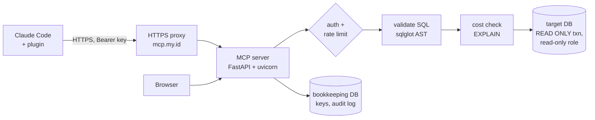

# Database MCP Server

An MCP server that lets an AI model explore a Postgres database and query
it, safely. Every query is parsed, cost-checked, run read-only and logged,
and the database itself refuses writes, so a validator bug doesn't become
a data-loss bug.

**Try it:** **https://mcp.my.id** has a walkthrough and a signup (no
invite needed). Install the Claude Code plugin and ask Claude about a
sample database ([how](#use-it)).

**Stack:** Python 3.12, FastAPI, the MCP Python SDK (Streamable HTTP),
SQLAlchemy (async) with asyncpg, sqlglot, PostgreSQL 16, Alembic. The
console is server-rendered Jinja2 with a little TypeScript. Deployed on a
small VPS; see [deploy/RUNBOOK.md](deploy/RUNBOOK.md).

## How it works



A query has to pass every layer, and each layer assumes the one before it
might fail:

1. **Auth:** a workspace API key in the `Authorization` header, stored only
   as a hash, revocable from the console, and limited to the tools it needs
   (full access, explore only, or schema only). Per-workspace rate limits.
2. **Validation:** exactly one `SELECT` (`UNION`, `INTERSECT` and `EXCEPT`
   allowed). The whole syntax tree is checked for hidden writes (a write
   inside a CTE, `SELECT INTO`) and row locks (`FOR UPDATE`), and only
   built-in functions are allowed.
3. **Cost check:** `EXPLAIN` estimates the cost before anything runs, and
   expensive queries are rejected.
4. **Execution limits:** a statement timeout, and results capped at 200 rows and 1 MB.
5. **The database itself:** every transaction is `READ ONLY`, and where
   possible the login is a read-only role too. Each covers a gap the other
   has (see the [threat model](docs/threat-model.md)).
6. **Audit:** every attempt, including rejected ones, is logged before a
   result is returned. A web console shows the log live, filterable by
   status and query text, with a 14-day chart.

Proven by an adversarial suite that sends writes straight to the database,
bypassing the validator: [red-team results](docs/red-team.md).

**How well an AI uses it:** on a 70-task benchmark, a small local model
(`qwen3.5:4b`) answered 64% correctly under strict grading, and none of its
34 write attempts got through ([benchmark](docs/benchmark.md)).

## Use it

1. **Sign up** at https://mcp.my.id with a username and a password of 12+
   characters. You get the demo database (Pagila, a DVD-rental store). An
   invite code lets you connect **your own Postgres** instead (its URL is
   stored encrypted; a read-only login is recommended).
2. **Copy your API key.** It's shown once. Issue more, optionally with less
   access, from the console's Keys page.
3. **Install the plugin** in Claude Code, and enter the key when asked:
   ```
   /plugin install mcp-backbone --marketplace NabilRobert/MCP-backbone
   ```
4. **Ask.** For example, "which film category has the most films?". Every
   query shows up on your console's dashboard.

Per workspace, per hour: 5 queries and 30 row samples by default; listing
and describing tables is free.

## Run it yourself

```bash
uv sync
cp .env.example .env            # fill in; APP_CONNECTION_ENCRYPTION_KEY is required
uv run alembic upgrade head
uv run uvicorn app.main:app --reload
```

One process serves the console (`/console`), the MCP endpoint (`/mcp/`) and
`/healthz`. Invite someone with
`uv run python -m scripts.create_invite --note "<who it's for>"`.

Running the tests (they need a disposable Postgres that can create roles)
and turning on tracing: [the guide](docs/guide.md#tests-tracing-and-local-development).

## Layout

```
app/auth/       workspaces, API keys, console logins, signup, rate limits
app/query/      validation, cost check, execution, address guard, audit log
app/console/    the web console
app/mcp/        the MCP tools: a thin adapter, no business logic
app/benchmark/  text-to-SQL eval cases and grading
migrations/     Alembic migrations for the bookkeeping database
tests/          tests against real Postgres, incl. the red-team suite
static-src/     the console's TypeScript (compiled into app/console/static)
plugin/         the Claude Code plugin (MCP registration + query skill)
deploy/         deployment files and the runbook
scripts/        operator CLIs: invites, seeding, datasets, benchmark
docs/           architecture, threat model, results, build log, planning
```

## Docs

- [Guide](docs/guide.md): start here. Screenshots, one request step by step,
  a glossary, and where to change things.
- [Architecture](docs/architecture.md), and the [decisions and plans](docs/planning/README.md) behind it.
- [Threat model](docs/threat-model.md), with [red-team results](docs/red-team.md).
- [Build log](docs/journey.md): what broke, and what it taught.

## License

[MIT](LICENSE).
