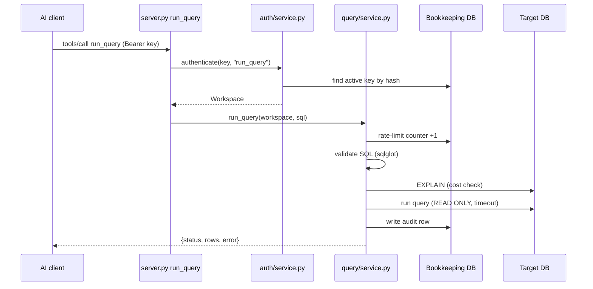

# Guide: how MCP-backbone works

A plain-English walk through the code. Read the flow first, look words up
in the glossary, and use the last section when you want to change
something. For the design reasons, see [architecture.md](architecture.md)
and the [decisions](planning/phase-5-architecture-decisions.md).

## What it is

An MCP server that lets an AI model look at a Postgres database and run
read-only SQL on it. Every query is checked, cost-estimated, run in a
read-only transaction and written to an audit log. People sign up on a
small web console, get an API key, and watch their audit log there. One
FastAPI process serves both the MCP endpoint (`/mcp/`) and the console
(`/console/`).

## The flow: one `run_query` call

An AI client (Claude Code with the plugin) asks: "run
`SELECT title FROM film`". Here is that request, start to finish.

1. **The request arrives.** `app/main.py: mcp_app` is the MCP SDK's HTTP
   app, mounted at `/mcp`. It checks the `Host` and `Origin` headers
   (`app/main.py: transport_security_for`) and hands the call to the
   tool. If tracing is on, the SDK opens a span for the call.
2. **The tool function runs.** `app/mcp/server.py: run_query` opens a
   session on the bookkeeping database (`app/db.py: SessionLocal`). It's
   wrapped by `app/mcp/server.py: _translate_errors`, which turns our own
   errors into a clean message the model can read.
3. **Who is asking?** `app/mcp/server.py: _resolve_api_key` reads the key
   from the `Authorization: Bearer` header. Then
   `app/auth/service.py: authenticate` hashes it
   (`app/auth/security.py: hash_api_key`), finds the active key row, and
   returns its `Workspace`. If the key's scopes don't include
   `run_query`, it raises `ToolNotPermitted`, and the refusal is still
   audited (`app/query/service.py: record_refusal`).
4. **Which database?** `app/query/service.py: get_data_source` finds the
   workspace's target database. A user's own URL is decrypted
   (`app/crypto.py: decrypt`) and checked again for private addresses
   (`app/query/network_guard.py: ensure_public_target`), because DNS can
   change after signup.
5. **Rate limit.** `app/query/service.py: _check_rate_limit` calls
   `app/auth/rate_limit.py: check_and_increment`: at most 5 queries per
   workspace per hour by default. Over the limit, the request ends here
   as `rejected`.
6. **Is the SQL safe?** `app/query/service.py: _validate` calls
   `app/query/validation.py: validate_and_normalize`. It parses the SQL
   with sqlglot and requires exactly one `SELECT`, with no write hidden
   anywhere inside it and no unknown functions. It adds `LIMIT 1000` if
   there's no limit. Nothing has touched the target database yet.
7. **Is it too expensive?** `app/query/service.py: _estimate_cost` calls
   `app/query/cost_check.py: check_cost`, which asks Postgres for the
   plan's cost with `EXPLAIN`, without running the query. Over 40,000,
   it's rejected.
8. **Run it.** `app/query/service.py: _execute` sets a 5-second statement
   timeout and calls `app/query/service.py: _run_with_retry`. That
   retries once if the connection dropped, but never if the query was
   just slow. `app/query/service.py: _fetch_capped` reads at most 200
   rows. The connection comes from `app/db.py: get_target_engine`, and
   every transaction on it is `READ ONLY`.
9. **Audit, then answer.** `app/query/service.py: _finish` calls
   `app/query/service.py: write_audit`, which saves one `QueryExecution`
   row (the audit log), and only then returns the result. If the audit
   write fails, the caller gets an error, not the rows.

Every step that can end the request returns a `QueryOutcome`
(`app/query/service.py: QueryOutcome`), and `_finish` audits it. So a
refused query is logged exactly like a successful one.

### The other three tools

- **`list_tables`:** `app/mcp/server.py: list_tables` →
  `app/query/service.py: list_tables`, which connects to the target and
  returns table names, hiding partitions
  (`app/query/service.py: visible_table_names`). Not rate-limited, not
  audited.
- **`describe_table`:** `app/mcp/server.py: describe_table` →
  `app/query/schema_cache.py: describe_table`. Columns come from a
  5-minute cache (`app/query/schema_cache.py: get_table_metadata`). Not
  rate-limited, not audited.
- **`sample_rows`:** `app/mcp/server.py: sample_rows` →
  `app/query/schema_cache.py: sample_rows`. Up to 100 rows of one real
  table. It returns real data, so it has its own rate limit (30 per hour)
  and is audited. The table name must exist in the schema, so there's no
  SQL from the model to validate.

### Console login

1. `GET /console/login` → `app/console/routes.py: login_form` renders
   the form, with a hidden CSRF token from
   `app/console/csrf.py: csrf_token`.
2. `POST /console/login` first passes
   `app/console/csrf.py: verify_csrf`, which runs on every console POST.
3. `app/console/routes.py: login_submit` checks the per-IP lockout
   (`app/console/throttle.py: is_blocked`), then
   `app/console/auth.py: verify_console_login`. That checks the password
   with Argon2 (`app/auth/security.py: verify_password`) and upgrades an
   old hash if needed.
4. On success, `app/console/auth.py: log_in` stores the workspace in the
   signed session cookie. A failure is recorded
   (`app/console/throttle.py: record`).
5. Later pages declare `app/console/routes.py: require_login`. Without a
   login it raises `LoginRequired`, and
   `app/console/routes.py: redirect_to_login` sends the browser back to
   the login page. The dashboard's TypeScript
   (`static-src/main.ts: refreshDashboard`) polls
   `app/console/routes.py: api_audit` and
   `app/console/routes.py: api_audit_daily` to draw the audit table and
   chart.

Signup is similar: `app/console/routes.py: signup_submit` →
`app/auth/signup.py: sign_up`, which makes a demo account
(`app/auth/signup.py: _sign_up_demo`) or, with an invite code, one that
may connect its own database (`app/auth/signup.py: _sign_up_invited`).
Both end in `app/auth/workspaces.py: create_workspace`.

### An admin script: issuing an invite

`python -m scripts.create_invite --note "alice"` →
`scripts/create_invite.py: main` → `scripts/create_invite.py: issue` →
`app/auth/signup.py: create_invite`. It stores only a hash of the code
and prints the code once. The other scripts work the same way:
`scripts/seed_workspace.py: seed` creates a workspace without an invite
(and is the only way to give one its own rate limits), and
`scripts/revoke_key.py: revoke` revokes a key.

## Glossary

| Term | Meaning | Where |
|---|---|---|
| MCP | Model Context Protocol: a standard way for an AI client to call tools on a server. | `app/mcp/server.py` |
| Tool | One function the AI can call: `list_tables`, `describe_table`, `sample_rows`, `run_query`. | `app/mcp/server.py` |
| Tool schema | The JSON description of a tool's arguments that the client reads. | `app/mcp/server.py: _StrictSchemaServer` |
| Strict mode | An OpenAI client setting that rejects a schema unless every argument is required and no extras are allowed. Our schemas are published that way. | `app/mcp/server.py: _StrictSchemaServer` |
| Streamable HTTP | The MCP transport this server speaks over the network. | `app/main.py: mcp_app` |
| `_meta` | Extra fields on an MCP request. Local callers (no HTTP headers) send the API key there. | `app/mcp/server.py: _resolve_api_key` |
| Workspace | One user or tenant. Owns keys, a login, a target database and an audit log. | `app/auth/models.py` |
| API key | The secret an AI client sends. Only its SHA-256 hash is stored. | `app/auth/security.py: hash_api_key` |
| Scope, preset | Which tools a key may call. Presets: full, explore, schema. | `app/auth/scopes.py: PRESETS` |
| Bookkeeping database | This app's own database: workspaces, keys, the audit log. | `APP_DATABASE_URL`, `app/db.py: SessionLocal` |
| Target database | The database the AI queries. The default one, or a user's own. | `app/query/models.py: DataSourceConnection` |
| Validator | The code that decides whether SQL is a single, harmless `SELECT`. | `app/query/validation.py: validate_and_normalize` |
| sqlglot, AST | sqlglot parses SQL into a tree (an AST), so we can check every part of it, not just the start. | `app/query/validation.py` |
| CTE | A `WITH x AS (...)` sub-query. It can hide a write, so the validator searches the whole tree. | `app/query/validation.py: WRITE_NODE_TYPES` |
| Function allowlist | Functions sqlglot doesn't know are refused, since one could secretly write. The list is empty on purpose. | `app/query/validation.py: ALLOWED_ANONYMOUS_FUNCTIONS` |
| `SECURITY DEFINER` | A Postgres function that runs with its owner's rights, so it can write even when called by a read-only login. | `docs/threat-model.md` |
| Cost check | Asking Postgres how expensive a query would be, and refusing it over a threshold. | `app/query/cost_check.py: check_cost` |
| `EXPLAIN` | The Postgres command that returns a query's plan and estimated cost without running it. | `app/query/cost_check.py: check_cost` |
| Statement timeout | A Postgres setting that kills a query after N seconds. Set per transaction with `SET LOCAL`. | `app/query/service.py: _execute` |
| `READ ONLY` transaction | Postgres refuses every write in it, even from a `SECURITY DEFINER` function. | `app/db.py: create_target_engine` |
| Read-only role | A database login that can only `SELECT`. A second guard behind the transaction. | `scripts/provision_readonly_role.py` |
| Row cap | At most 200 rows go back to the model; more are cut off with a note. | `app/query/service.py: _fetch_capped` |
| Rate limit | At most N calls per workspace per hour. A fixed window, counted in the database. | `app/auth/rate_limit.py: check_and_increment` |
| Audit log | One `QueryExecution` row per attempt, refused or not. The console shows it. | `app/query/service.py: write_audit` |
| `QueryOutcome` | How one attempt ended: status, reason, cost, rows. | `app/query/service.py: QueryOutcome` |
| Schema cache | A 5-minute copy of table and column names, for the browsing tools only. | `app/query/schema_cache.py: get_table_metadata` |
| Network guard | Refuses a database URL that points at a private or local address (SSRF protection). | `app/query/network_guard.py: ensure_public_target` |
| SSRF | Tricking a server into connecting somewhere it shouldn't, like its own internal database. | `app/query/network_guard.py` |
| Fernet | Symmetric encryption from the `cryptography` library. Encrypts stored database URLs. | `app/crypto.py: encrypt` |
| Argon2 | A slow, memory-hard password hash. Older scrypt hashes are upgraded at login. | `app/auth/security.py: hash_password` |
| CSRF | A trick where another site makes your browser submit a form. Every console form carries a token to stop it. | `app/console/csrf.py: verify_csrf` |
| Session cookie | The signed cookie that remembers a console login. | `app/main.py`, `app/console/auth.py: log_in` |
| Throttle | Per-IP limits on failed logins and demo signups. | `app/console/throttle.py: is_blocked` |
| Invite code | A single-use code that lets someone connect their own database at signup. | `app/auth/signup.py: create_invite` |
| Alembic migration | A versioned script that changes the bookkeeping database's tables. | `migrations/versions/` |
| Span, trace | OpenTelemetry's record of one timed step (span) and a whole request (trace). Off unless an endpoint is set. | `app/tracing.py: stage` |
| Build version | The running git commit, shown by `/healthz`. | `app/version.py: BUILD_VERSION` |
| Benchmark | 30 questions asked through the real tools, graded on the rows returned. | `scripts/run_benchmark.py: run`, `app/benchmark/grading.py` |
| Red-team suite | Tests that try to write through the database layers directly, skipping the validator. | `tests/test_red_team.py` |
| Plugin | The Claude Code plugin: registers the server and a skill telling Claude how to use it. | `plugin/` |

## Where to change things

- **Run everything locally:** the README's "Run it yourself" section.
  Checks, as CI runs them: `uv run ruff check .`,
  `uv run pyright app/ tests/ scripts/`, `uv run pytest` (needs the
  test database from the README).
- **Change a limit:** set it in `.env`. Each has a comment in
  `.env.example`, and the defaults live in `app/config.py: Settings`.
  Row cap: `APP_MAX_RESULT_ROWS`. Timeouts: `APP_QUERY_TIMEOUT_SECONDS`,
  `APP_EXPLAIN_TIMEOUT_SECONDS`. Cost: `APP_COST_THRESHOLD`. Rate limits:
  `APP_DEMO_RATE_LIMIT` and `APP_SAMPLE_RATE_LIMIT`; for one workspace
  only, `scripts/seed_workspace.py --query-rate-limit`.
- **Allow a SQL function:** add its lower-case name to
  `ALLOWED_ANONYMOUS_FUNCTIONS` in `app/query/validation.py`, only after
  checking it can't write. Add a test in `tests/test_validation.py`.
- **Add a tool:**
  1. Write the logic in `app/query/`.
  2. Add a scope constant to `app/auth/scopes.py` and to `ALL_TOOLS` and
     the presets.
  3. Add the tool to `app/mcp/server.py` like the others:
     `@mcp.tool()`, `@_translate_errors`, `_authenticate` with the new
     scope. Every argument must be required (strict mode).
  4. Existing keys store their scopes, so they won't include the new
     tool. Add a migration that adds it to existing keys' `scopes`.
  5. Add it to the plugin's skill (`plugin/skills/query-database/SKILL.md`)
     and write tests.
- **Add a migration:** change the model in `app/auth/models.py` or
  `app/query/models.py`, then
  `uv run alembic revision --autogenerate -m "what changed"`. Read the
  new file in `migrations/versions/` (autogenerate misses things), then
  `uv run alembic upgrade head`.
- **Change the console:** pages are `app/console/routes.py` and
  `app/console/templates/`. The dashboard script is `static-src/main.ts`;
  run `npm run build` in `static-src/` and commit the built
  `app/console/static/main.js` (CI checks they match).
- **Deploy:** follow the steps in [the runbook](../deploy/RUNBOOK.md), in
  order: sync dependencies and migrate before restarting.
